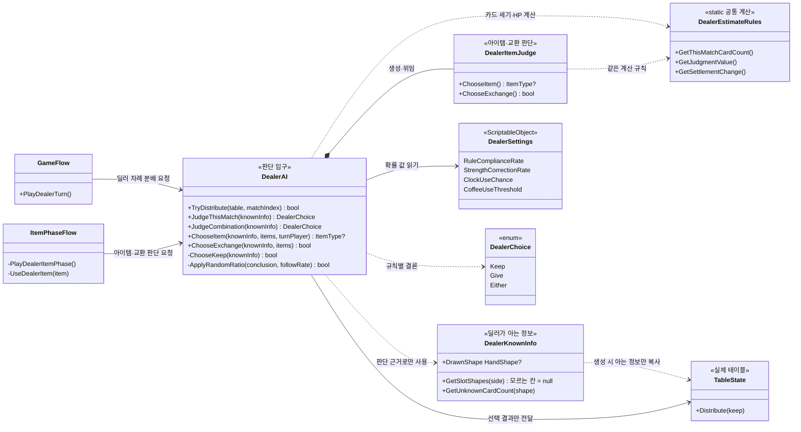
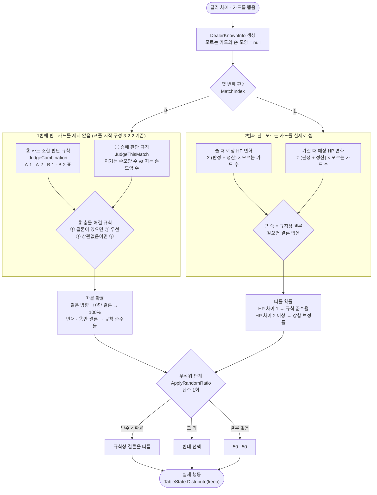
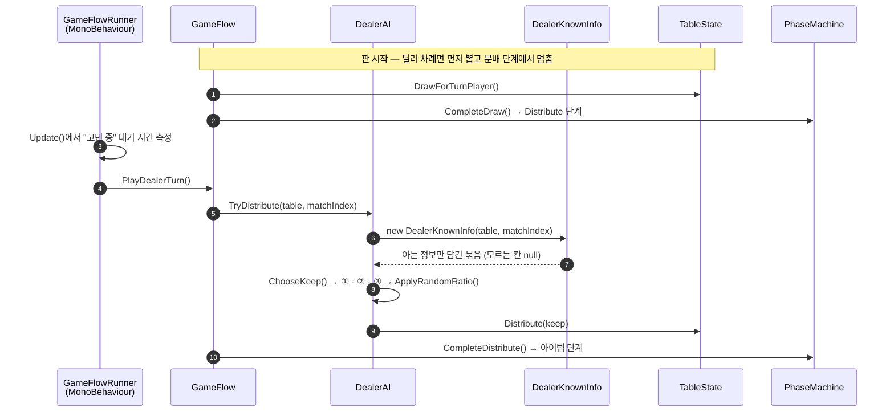

# 딜러 AI — "아는 정보만으로" 판단하는 규칙 기반 AI

> 핵심 클래스: `DealerAI` · `DealerKnownInfo` · `DealerEstimateRules` · `DealerItemJudge` · `DealerSettings`
> 위치: `Assets/Scripts/Enemy/`

---

## 1. 구현 배경

- RSPRullet은 딜러와 카드를 주고받으며 수 싸움을 하는 심리전 게임이다. 턴 플레이어는 뽑은 카드를 **가질지 / 상대에게 줄지** 고르고, 이 선택이 이번 판 승패와 마지막 카드 조합(트리플·풀세트)에 함께 영향을 준다.
- 딜러가 숨은 카드를 보고 판단하면 불공정하고, 무작위로 고르면 심리전이 성립하지 않는다. 그래서 딜러 AI에 다음 네 가지를 요구했다.

| 요구 | 내용 |
| --- | --- |
| 치트 금지 | 딜러는 **딜러가 아는 정보**(공개 카드, 자기가 본 카드, 카드풀 구성, 미공개 카드 수)만 쓴다 |
| 설명 가능한 판단 | 플레이어가 "딜러가 왜 그렇게 했는지" 납득할 수 있는 규칙으로 고른다 |
| 난이도 조절 | 코드 수정 없이 딜러의 강함·예측 어려움을 바꿀 수 있다 |
| 재현 가능 | 같은 상황을 다시 만들어 판단이 기획서대로인지 테스트할 수 있다 |

---

## 2. 구현 방법

### 2-1. 클래스 구성



| 클래스 | 역할 |
| --- | --- |
| `DealerAI` | 딜러 판단의 **유일한 입구**. 카드 분배를 직접 판단하고, 아이템·교환 판단은 `DealerItemJudge`에 넘긴다 |
| `DealerKnownInfo` | 테이블에서 **딜러가 아는 것만** 옮겨 담은 판단 근거. 모르는 카드는 `null`로 남긴다 |
| `DealerEstimateRules` | 카드 세기와 판정·정산 HP 변화 계산. 분배 판단과 아이템 판단이 같은 셈을 쓰도록 한곳에 모았다 |
| `DealerItemJudge` | 돋보기 → 시계 → 커피 순서로 쓸 아이템과 돋보기 뒤 교환 여부를 정한다 |
| `DealerSettings` | 규칙 준수율·강함 보정률 등 확률 값. ScriptableObject라 인스펙터에서 조절한다 |

- 딜러는 **선택만** 한다. 카드를 어느 자리에 놓을지는 `TableState`, 아이템 효과 적용은 `ItemPhaseFlow`가 플레이어와 같은 코드로 처리한다.

### 2-2. 판단 흐름: 규칙상 결론 → 무작위 단계 → 실제 행동



- **1번째 판** — ① 승패 판단 규칙과 ② 카드 조합 판단 규칙으로 각각 `Keep / Give / Either`를 판단하고, ③ 충돌 해결 규칙으로 하나의 결론을 낸다.
  - 1번째 판은 일부러 카드를 세지 않는다(셔플 시작 구성 기준). 플레이어가 옳고 그름을 확인하기 어려운 판이라 체감 없이 딜러를 약하게 만드는 **숨은 약화**다.
- **2번째 판** — 모르는 카드를 한 장씩 상대 자리에 넣어 보고 `예상 HP 변화 = 판정 시 HP 변화 + 정산 시 HP 변화`를 가질 때·줄 때 각각 합산해 비교한다. 이번 판을 지더라도 트리플(상대 −3)을 완성하는 선택을 고를 수 있다.
- **무작위 단계** — 규칙상 결론을 확률만큼만 따른다. 확률은 상황별로 달라 "반대로 가면 손해만 보는 상황"에서는 항상 따르고, 두 선택 모두 근거가 있는 상황에서만 흔들린다.

### 2-3. 핵심 코드

**치트 금지를 구조로 막기** — `DealerKnownInfo`는 생성 시점에 모르는 카드의 손 모양을 담지 않는다. 판단 코드는 이 묶음만 받으므로, 실수로라도 숨은 카드를 읽을 수 없다.

```csharp
// DealerKnownInfo.cs — 딜러가 모르는 카드는 null로 남긴다 (칸 순서는 유지)
private static void CopyShapesKnownByDealer(IReadOnlyList<Card> slots, List<HandShape?> shapes)
{
    foreach (Card card in slots)
    {
        shapes.Add(card.KnownByDealer ? card.Shape : (HandShape?)null);
    }
}
```

**무작위 단계** — 판단 한 번에 난수는 한 번만 뽑는다. 확률 값을 바꿔도 같은 시드의 이후 난수 순서가 그대로라 테스트 재현이 깨지지 않는다.

```csharp
// DealerAI.cs
private bool ApplyRandomRatio(DealerChoice conclusion, float followRate)
{
    if (conclusion == DealerChoice.Either)
    {
        return _random.Next(2) == 0;               // 결론 없음: 50:50
    }

    bool ruleKeep = conclusion == DealerChoice.Keep;
    bool follows = _random.NextDouble() < followRate;
    return follows ? ruleKeep : !ruleKeep;
}
```

### 2-4. 호출 흐름 (딜러 차례의 분배)



---

## 3. 구현 결과

- 딜러 AI 세부 기획서의 판단 예시 1~5(1번째 판 충돌, 2번째 판 트리플 우선, 돋보기 후 교환 안 함 등)를 EditMode 테스트로 그대로 재현했다. (`DealerAITests` 테스트 43개)
- 규칙 준수율·강함 보정률·시계 사용 확률·커피 사용 기준을 `DealerSettings` 에셋으로 분리해, 코드 수정 없이 딜러의 강함을 바꿀 수 있는 입구를 마련했다. (실제 난이도 조절은 5장 참고)
- 판단마다 콘솔에 "규칙상 결론 / 따를 확률 / 따름·반대 선택"을 남겨 Play 중 딜러의 선택 이유를 바로 확인할 수 있다.
- 분배 판단과 아이템·교환 판단이 같은 계산 규칙(`DealerEstimateRules`)을 써서, 같은 판 안에서 두 판단의 셈 방법이 어긋나지 않는다.

---

## 4. 방법 채택 이유 — 왜 규칙 기반 AI인가

딜러 AI의 틀을 정하기 전에, 이 게임에서 딜러가 놓인 조건부터 정리했다.

- **행동이 단순하다**: 턴제 진행에서 딜러가 고르는 것은 카드를 `가진다 / 준다`와 아이템 사용 정도다.
- **상대 카드를 모른다**: 숨은 카드를 두고 수를 읽는 것이 게임의 핵심 재미다.
- **딜러 품질이 곧 게임의 재미다**: 상대가 딜러 하나뿐이라, 딜러가 반칙하거나(공정함) 이유 없이 고르거나(합리성) 뻔하면(예측 불가) 게임의 근간이 무너진다.

이 조건으로 대표적인 게임 AI 설계 네 가지를 비교했다.

| 설계 방식 | 개념 | 이 프로젝트에서의 판단 | 결정 |
| --- | --- | --- | --- |
| 행동 트리 (Behavior Tree) | 조건·행동 노드를 트리로 엮어 상태별 행동을 고른다 | 이동·전투·감지·도망처럼 **상태가 많은 NPC**에 맞는 구조다. 딜러는 가진다/준다만 고르므로 구조가 과하다 | 제외 |
| 탐색 (Minimax · MCTS) | Minimax는 모든 수를 펼쳐 최선을 계산하고, MCTS는 시뮬레이션을 반복해 승률 높은 수를 고른다 | Minimax는 **모든 정보가 공개된 게임**을 전제로 하고, MCTS는 모르는 카드를 추측해 채우는 변형이 필요하다. 상대 카드를 모르는 것이 핵심인 게임과 전제가 맞지 않고, 보완하더라도 **사람 같은 무작위성**으로 조절하기 어렵다 | 제외 |
| 유틸리티 AI | 행동마다 "지금 얼마나 좋은가"를 점수로 계산해 가장 높은 행동을 고른다 (예: 욕구 점수를 비교하는 생활 시뮬레이션 캐릭터) | 이번 판 승패와 카드 조합이라는 두 기준의 **가중치·계산식을 정하기 어렵고**, 딜러가 왜 골랐는지 **점수표 없이는 설명할 수 없다** | 제외 |
| **규칙 기반 (If-Then)** | 기획서에 적힌 판단 규칙을 조건문으로 옮긴다 | 판단 구조가 **기획서 규칙과 1:1로 대응**해, 딜러가 왜 골랐는지 기획서의 언어로 설명할 수 있다. 이상한 선택이 나와도 **어느 규칙이 틀렸는지 바로 찾을 수 있다** | **선택** |

**선택 근거**

- 프로젝트 기간과 개인 기술 수준을 고려하면, 기획서의 문장을 그대로 코드로 옮겨 구현 논리를 직관적으로 이해하고 오류를 쉽게 찾을 수 있는 구조가 가장 중요했다.
- 규칙 기반을 고른 효과는 무작위 단계까지 이어진다. 확률로 규칙과 반대 선택을 해도 로그에 `규칙상 결론: 가진다, 반대 선택`처럼 결론이 남아, 무작위가 섞인 행동도 이유를 설명할 수 있다.

---

## 5. 회고 및 마무리

### 5-1. 구현 결과

| 구현 조건 | 핵심 구조 | 결과 |
| --- | --- | --- |
| 공정함 — 반칙하지 않는 딜러 | 딜러가 아는 정보(`DealerKnownInfo`) | 구현 완료 |
| 합리성 — 근거 있게 고르는 딜러 | ① 승패 판단 · ② 카드 조합 판단 → ③ 충돌 해결 | 구현 완료 |
| 예측 불가 — 뻔하지 않은 딜러 | 무작위 단계 (`ApplyRandomRatio`) | **입구까지만 구현** (목표 달성은 실패) |

- 규칙 준수율과 강함 보정률을 설정 에셋에서 조절할 수 있는 입구는 열어 두었지만, 현재 값은 둘 다 1.0이다. 그래서 실제로 무작위로 정해지는 경우는 두 선택이 똑같이 좋은 50:50 상황뿐이고, 라운드별 난이도 조절은 남은 과제다.

### 5-2. 느낀 점

- 규칙 기반을 고른 이유는 AI 도구(Claude)와 함께 작성한 코드를 내가 이해할 수 있게 하기 위해서였다. 실제로 규칙 하나, 메서드 몇 줄 단위로는 이해할 수 있었다.
- 하지만 이슈를 처리하며 코드가 쌓일수록, 딜러의 행동 로직이 전체적으로 어떻게 이어지는지는 따라가기 어려워졌다. 설명할 수 있었던 것은 중간 보고에서 본 코드 조각뿐이었고, 그 결과 조절 값의 입구는 열어 두었지만 실제 난이도에 맞추는 데까지는 가지 못했다.
- 줄 단위 이해를 내려놓고 처음부터 전체 구조를 이해하는 것을 전제로 작업을 맡겼다면, 딜러를 더 발전시킬 수 있었을 것이라는 아쉬움이 남는다.
- **AI와 함께 만들 때는 코드 한 줄을 이해하는 것보다, 전체 구조를 이해하는 것이 먼저다.**
