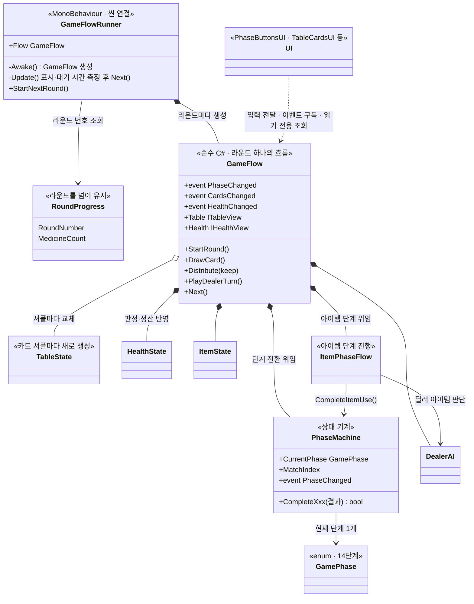
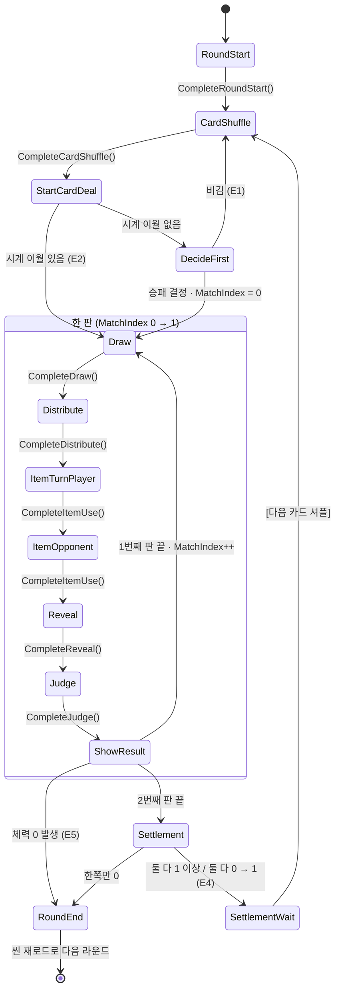
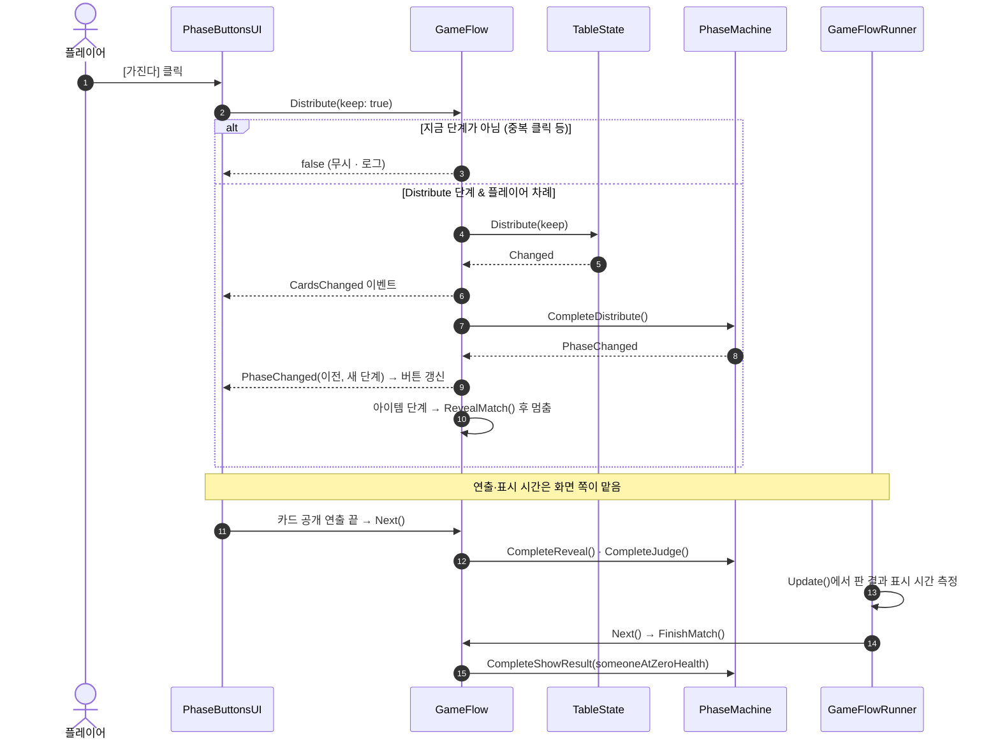

# 게임 진행 흐름 — 유한 상태 기계(FSM) 기반 라운드 진행

> 핵심 클래스: `PhaseMachine` · `GamePhase` · `GameFlow` · `GameFlowRunner`
> 위치: `Assets/Scripts/Core/`, `Assets/Scripts/Enums/`

---

## 1. 구현 배경

- 한 라운드는 **카드 셔플**을 반복하고, 카드 셔플 한 번은 `선 정하기 → 2판 승부 → 정산`으로 이루어진다. 한 판 안에도 `뽑기 → 분배 → 아이템(턴 플레이어 → 상대) → 공개 → 판정 → 결과 표시`의 세부 단계가 있다.
- 흐름이 일직선이 아니라 **되돌아가거나 중간에 끝나는 분기**가 많다. 선 정하기가 비기면 카드 셔플로 되돌아가고(약 24% 확률, 반복 상한 없음), 시계 이월이 있으면 선 정하기를 건너뛰며, 판정 중 체력이 0이 되면 남은 판과 정산 없이 라운드가 끝난다. 정산 후 양쪽 체력이 모두 0이면 둘 다 1로 되돌리고 라운드를 계속한다.
- 여기에 플레이어 버튼 입력, 딜러의 "고민 중" 대기, 카드 공개 연출, 결과 표시 시간이 섞인다. 그래서 진행 구조에 다음 네 가지를 요구했다.

| 요구 | 내용 |
| --- | --- |
| 분기를 한곳에서 | 되돌아가기·건너뛰기·중간 종료를 포함한 **모든 단계 전환**을 한 곳에서 정한다 |
| 잘못된 입력 차단 | 버튼 중복 클릭, 연출 중 입력처럼 **지금 단계에 맞지 않는 입력**은 상태를 바꾸지 않는다 |
| 규칙과 연출 분리 | 연출·표시 시간을 바꾸거나 화면 기능을 늘려도 규칙 흐름 코드는 바뀌지 않는다 |
| 재현 가능 | Scene 없이 라운드 전체를 진행해, 드문 분기까지 테스트로 다시 만들 수 있다 |

---

## 2. 구현 방법

### 2-1. 클래스 구성



| 클래스 | 역할 |
| --- | --- |
| `PhaseMachine` | 단계 전환의 **유일한 입구**. 현재 단계(`GamePhase`) 1개와 판 번호를 가지고, 완료 신호에 맞는 다음 단계만 정한다. 승패·체력 계산은 하지 않는다 |
| `GamePhase` | 라운드 시작부터 라운드 종료까지 14개 단계를 나타내는 enum |
| `GameFlow` | 라운드 하나의 흐름. 입력을 확인하고, 계산은 상태 클래스(`TableState`·`HealthState`·`ItemPhaseFlow`)에 맡기며, 입력이 필요한 **멈출 지점**까지 진행한다 |
| `GameFlowRunner` | Scene과의 연결. 설정 에셋으로 `GameFlow`를 만들고, 표시·대기 시간을 잰 뒤 `Next()`를 넣고, 라운드 전환(씬 재로드)을 맡는다 |
| `RoundProgress` | 씬을 다시 불러와도 남아야 하는 값(라운드 번호, 응급약 복용 횟수)만 가진다 |

- `PhaseMachine`과 `GameFlow`는 **순수 C# 클래스**라 Scene 없이 EditMode 테스트로 라운드 전체를 진행할 수 있다. 시간 대기와 연출은 `GameFlowRunner`와 화면이 맡는다.
- 화면(UI)은 `GameFlow`에 **입력만** 넘기고, 이벤트를 구독해 읽기 전용 인터페이스(`ITableView`, `IHealthView`, `IItemView`)로 상태를 읽는다. 상태를 바꾸는 것은 `GameFlow`의 입력과 진행뿐이다.

### 2-2. 진행 흐름: 완료 신호 → 다음 단계 결정 → 멈출 지점



- **단계 정의** — 코어 규칙 상세 기획서의 진행 단계(①~⑦, 5-1~5-7)에 정산 뒤 [다음 카드 셔플] 대기를 더해 `GamePhase` 14개 값으로 정의했다.
- **완료 신호** — 모든 전환은 "지금 단계가 끝났다"는 신호(`CompleteDraw()` 등)로만 일어난다. 되돌아가기(E1 비김 → 셔플), 건너뛰기(E2 시계 이월), 중간 종료(E5 판정 중 체력 0)도 이 신호의 결과 값으로 갈리므로, **분기 규칙이 모두 `PhaseMachine` 한 곳**에 모인다.
- **멈출 지점** — `GameFlow`는 입력이 필요한 곳(플레이어 버튼, 딜러 고민 중, 연출·표시 대기)에서만 멈추고 나머지 단계는 시간 없이 이어서 진행한다. 화면이 연출을 마치거나 `GameFlowRunner`가 표시 시간을 다 재면 `Next()` 하나로 다시 이어진다.

### 2-3. 핵심 코드

**맞지 않는 신호를 구조로 막기** — 전환은 기대한 단계일 때만 일어나고, 아니면 상태를 바꾸지 않고 `false`를 돌려준다. 중복 클릭·연출 중 입력을 UI마다 따로 막지 않아도 된다.

```csharp
// PhaseMachine.cs
public bool CompleteDraw()
{
    return TryMove(GamePhase.Draw, GamePhase.Distribute);
}

private bool TryMove(GamePhase expected, GamePhase next)
{
    if (CurrentPhase != expected)
    {
        return Ignore($"{expected} 완료");   // 중복 클릭·연출 중 입력은 로그만 남기고 무시
    }

    Move(next);                              // 단계 변경 → PhaseChanged 이벤트
    return true;
}
```

**분기는 호출하는 쪽이 넘긴 결과로만 정한다** — 상태 기계는 체력을 계산하지 않고, 결과 값만 받아 다음 단계를 고른다.

```csharp
// PhaseMachine.cs — 판 결과 표시가 끝난 뒤
public bool CompleteShowResult(bool someoneAtZeroHealth)
{
    if (CurrentPhase != GamePhase.ShowResult) { return Ignore(nameof(CompleteShowResult)); }

    if (someoneAtZeroHealth) { Move(GamePhase.RoundEnd); return true; }   // 남은 판·정산 없이 종료

    if (MatchIndex < GameRules.MatchesPerShuffle - 1)
    {
        MatchIndex++;
        Move(GamePhase.Draw);                                               // 두 번째 판
        return true;
    }

    Move(GamePhase.Settlement);
    return true;
}
```

**멈출 지점에서 다시 이어가기** — 연출·표시 대기가 끝났다는 입력은 `Next()` 하나로 받고, 현재 단계에 따라 다음 진행을 고른다.

```csharp
// GameFlow.cs — 화면 표시·연출이 끝났을 때 받는 공통 입력
public bool Next()
{
    switch (CurrentPhase)
    {
        case GamePhase.Reveal:     JudgeMatch();  return true;   // 카드 공개 연출 끝 → 판정
        case GamePhase.ShowResult: FinishMatch(); return true;   // 결과 표시 끝 → 다음 판/정산/종료
        // … 카드풀 공개, 선 정하기 결과, 정산, 다음 카드 셔플 대기
        default:                   return Ignore(nameof(Next));
    }
}
```

### 2-4. 호출 흐름 (플레이어의 분배 입력)



---

## 3. 구현 결과

- 라운드 시작부터 라운드 종료까지 14단계와 예외 분기(E1 비김 복귀, E2 시계 이월, E4 양쪽 체력 0, E5 판정 중 종료)를 상태 기계 하나로 처리한다.
- Scene 없이 시드를 고정한 난수로 라운드 전체를 EditMode에서 진행해, "선 정하기가 비기는 상황", "판정 중 체력 0" 같은 드문 분기도 재현해 검증했다. (`PhaseMachineTests` 테스트 14개, `GameFlowTests` 테스트 42개)
- 버튼 중복 클릭·연출 중 입력은 단계 확인으로 모두 무시되고, 화면 버튼 활성화도 현재 단계만 보고 정해진다.
- 개발 중 기능이 계속 추가되었지만 구조는 유지되었다.
  - 아이템 단계를 `ItemPhaseFlow`로 분리할 때 게임 진행 테스트를 고치지 않고 모두 통과했다.
  - 카드 공개 연출 대기, 진행 안내 배너, 정산 결과 표시/다음 셔플 대기 분리는 `Next()`의 멈춤 지점 추가와 단계 1개 추가로 해결했다.
- 라운드 전환은 씬을 다시 불러와 `GameFlow`를 새로 만드는 방식이라, 체력·아이템·진행 단계 초기화 코드가 따로 필요 없다.

---

## 4. 방법 채택 이유 — 왜 상태 기계인가

진행 구조의 틀을 정하기 전에, 이 게임의 라운드 진행이 놓인 조건부터 정리했다.

- **단계는 많지만 동시에 하나뿐이다**: 14개 단계가 있지만 어느 순간이든 진행 중인 단계는 하나다.
- **되돌아가고 중간에 끝난다**: 비김 복귀, 시계 이월 건너뛰기, 판정 중 종료처럼 순서대로만 흐르지 않는다.
- **입력과 시간이 섞인다**: 플레이어 버튼, 딜러 대기, 연출·표시 시간이 단계 사이사이에 끼어든다.

이 조건으로 대표적인 진행 구현 방식 네 가지를 비교했다.

| 설계 방식 | 개념 | 이 프로젝트에서의 판단 | 결정 |
| --- | --- | --- | --- |
| 코루틴·async 순차 진행 | 단계를 코드 순서대로 적고 `yield`·`await`로 입력과 시간을 기다린다 | 일직선 흐름에는 읽기 쉽지만, 비김 복귀·체력 0 중간 종료가 **반복문과 중단 처리로 복잡**해진다. 시간이 흘러야 진행되어 EditMode 테스트가 어렵다 | 제외 |
| bool 플래그 조합 | `isDrawing`, `isRevealing`처럼 상태마다 플래그를 두고 조합으로 판단한다 | 단계가 늘수록 플래그가 늘고, **두 플래그가 동시에 참인 잘못된 상태**를 구조적으로 막지 못한다 | 제외 |
| State 패턴 | 단계마다 클래스를 만들고, 각 클래스가 진입·처리·다음 단계를 맡는다 | 단계마다 하는 일이 진입·종료 처리 없이 "다음으로 넘기기"뿐이라 **클래스만 14개 늘어난다** | 제외 |
| **상태 기계 (enum + 단계별 완료 메서드)** | 현재 단계를 enum 하나로 두고, `CompleteDraw()`처럼 단계별 완료 신호로만 전환한다 | 동시에 하나의 단계만 존재하고, **전환 규칙이 기획서 진행 단계와 1:1로 대응**한다. 호출부만 보고 무엇이 끝났는지 읽힌다 | **선택** |

**선택 근거**

- 기획서의 진행 단계를 그대로 enum 값과 완료 메서드로 옮겨, 흐름이 이상할 때 **어느 전환이 틀렸는지 바로 찾을 수 있는 구조**가 가장 중요했다.
- 상태 기계를 고른 효과는 실행 구조까지 이어진다. 전환이 시간과 무관한 신호로만 일어나므로 흐름 로직을 순수 C#(`GameFlow`)에 두고 시간 대기는 MonoBehaviour(`GameFlowRunner`)에 맡길 수 있었고, 그 덕분에 테스트가 즉시 끝나며 연출 시간 조정이 흐름 코드를 건드리지 않는다.
- 상태 변경 알림은 `UnityEvent` 대신 C# `event`를 썼다. 순수 C# 클래스에서 쓸 수 있고, 바깥에서 알림을 보내거나 구독자를 지우지 못하게 막는다.

---

## 5. 회고 및 마무리

### 5-1. 구현 결과

| 구현 조건 | 핵심 구조 | 결과 |
| --- | --- | --- |
| 분기를 한곳에서 | 단계별 완료 메서드 (`PhaseMachine`) | 구현 완료 |
| 잘못된 입력 차단 | 기대 단계 확인 후 무시 (`TryMove` · `Ignore`) | 구현 완료 |
| 규칙과 연출 분리 | 멈출 지점 + `Next()`, 시간은 `GameFlowRunner` | 구현 완료 |
| 재현 가능 | 순수 C# `GameFlow` + 시드 고정 난수 | **대부분 구현** (양쪽 체력 0 정산은 EditMode 테스트로만 확인) |

- 정산에서 양쪽 체력이 동시에 0이 되는 경우는 Play에서 만들기 어려워 EditMode 테스트로만 확인했다.

### 5-2. 느낀 점

- "전환은 `PhaseMachine`, 흐름은 `GameFlow`, 시간은 화면"으로 책임을 처음에 나눠 둔 덕분에, 연출·배너·튜토리얼 같은 표시 기능이 늘어나도 규칙 흐름 코드는 거의 바뀌지 않았다.
- 반면 단계 수를 늘리지 않으려고 기획서의 화면 상태(카드풀 공개, 카드 섞기 연출, 카드 정산 배너 대기 등) 일부를 `GameFlow` 안의 bool 값(`_isFirstTurnDecided`, `_isSettlementApplied`)과 조회 프로퍼티로 처리했다. 그 결과 현재 상태를 알려면 enum과 bool을 함께 봐야 해서, 4장에서 제외한 bool 플래그 조합의 단점이 일부 다시 들어왔다.
- 기능 추가에 따라 `GameFlow`는 400줄 이상으로 커졌고, `GameFlowRunner.Update()`는 대기 종류마다 남은 시간을 따로 재는 메서드 6개를 가지게 되었다. 아이템 단계처럼 독립된 구간(카드 셔플·선 정하기)을 별도 클래스로 나누고, 대기 시간 측정을 공통 타이머로 묶는 것이 남은 개선 과제다.
- 앞으로는 단계를 나눴다는 것에만 만족하지 말고, 프로젝트가 완성되어 가며 연출·배너·튜토리얼처럼 늘어날 부분까지 고려해 상태를 분류해야 한다.
- 또 상태 기계를 썼다는 점에 매몰되어 모든 것을 상태 하나(`GamePhase`)에 담으려는 오류를 범하지 말자. 아이템 단계를 `ItemPhaseFlow`로 나눴던 것처럼, 독립된 구간은 따로 떼어 내는 편이 낫다.
- **상태는 지금 필요한 만큼이 아니라, 게임이 커졌을 때를 생각하며 나눠야 한다.**
