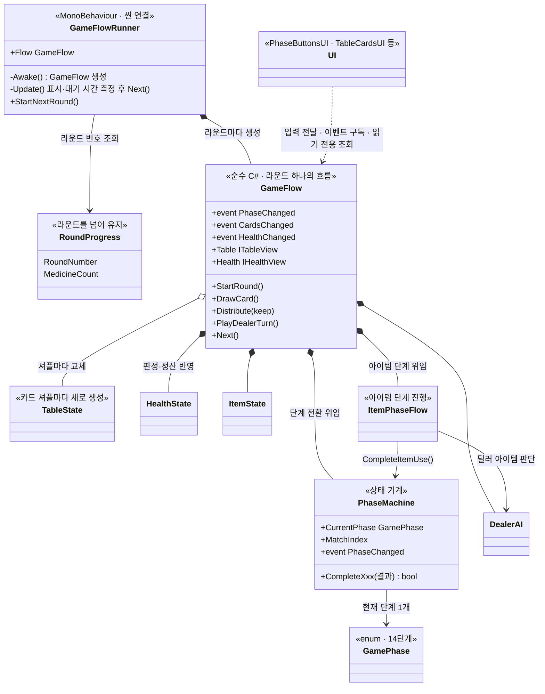
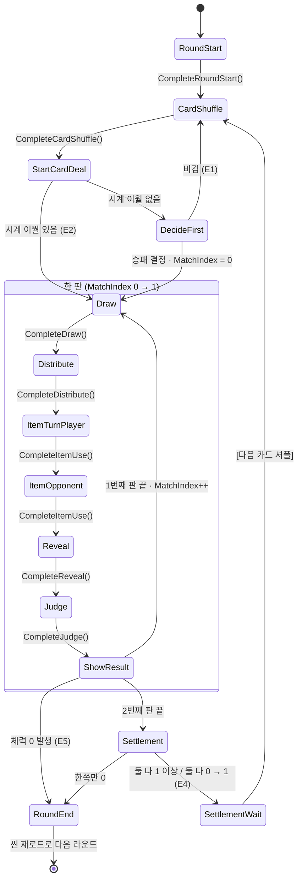
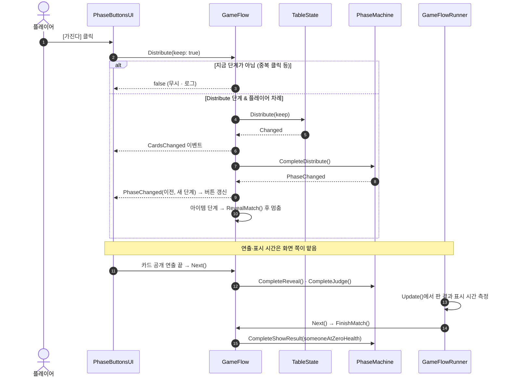

# 게임 진행 흐름 — 유한 상태 기계(FSM) 기반 라운드 진행

> 핵심 클래스: `PhaseMachine` · `GamePhase` · `GameFlow` · `GameFlowRunner`
> 위치: `Assets/Scripts/Core/`, `Assets/Scripts/Enums/`

---

## 1. 구현 배경

- 한 라운드는 **카드 셔플**을 반복하고, 카드 셔플 한 번은 `선 정하기 → 2판 승부 → 정산`으로 이루어진다. 한 판 안에도 `뽑기 → 분배 → 아이템(턴 플레이어 → 상대) → 공개 → 판정 → 결과 표시`의 세부 단계가 있다.
- 흐름이 일직선이 아니라 **되돌아가거나 중간에 끝나는 분기**가 많다.

| 분기 | 처리 |
| --- | --- |
| 선 정하기 무승부 | 카드 셔플로 되돌아감 (약 24% 확률, 반복 상한 없음) |
| 시계 이월 | 선 정하기를 건너뛰고 바로 첫 번째 판 |
| 판정 중 체력 0 | 남은 판과 정산 없이 즉시 라운드 종료 |
| 정산 후 양쪽 체력 0 | 둘 다 1로 되돌리고 라운드 계속 |

- 여기에 플레이어 버튼 입력, 딜러의 "고민 중" 대기, 카드 공개 연출, 결과 표시 시간이 섞인다. 버튼 중복 클릭이나 연출 중 입력처럼 **지금 단계에 맞지 않는 입력**을 안전하게 걸러야 했다.

---

## 2. 구현 방법

### 2-1. 3계층 구조: 전환 / 흐름 / Unity 연결



| 계층 | 클래스 | 맡는 일 | 맡지 않는 일 |
| --- | --- | --- | --- |
| 전환 | `PhaseMachine` | 현재 단계(`GamePhase`) 1개와 판 번호를 가지고, 완료 신호에 맞는 **다음 단계만** 정한다 | 승패·체력 계산, 화면 |
| 흐름 | `GameFlow` | 입력 확인, 상태 클래스에 계산 위임, **멈출 지점** 결정, 상태 변경 알림 전달 | 시간 대기, 연출 |
| Unity 연결 | `GameFlowRunner` | 설정 에셋으로 `GameFlow` 생성, 표시·대기 시간을 재고 `Next()` 입력, 라운드 전환(씬 재로드) | 규칙·흐름 판단 |

- `PhaseMachine`과 `GameFlow`는 **순수 C# 클래스**라 Scene 없이 EditMode 테스트로 라운드 전체를 진행할 수 있다.
- 화면(UI)은 `GameFlow`에 입력만 넘기고, 이벤트를 구독해 **읽기 전용 인터페이스**(`ITableView`, `IHealthView`, `IItemView`)로 상태를 읽는다. 상태를 바꾸는 것은 `GameFlow`의 입력과 진행뿐이다.

### 2-2. 상태 전이



- 코어 규칙 상세 기획서의 진행 단계(①~⑦, 5-1~5-7)에 정산 뒤 [다음 카드 셔플] 대기를 더해 `GamePhase` 14개 값으로 정의했다.
- 되돌아가기(비김 → 셔플), 건너뛰기(시계 이월), 중간 종료(체력 0)가 모두 **전이 규칙 한 곳**(`PhaseMachine`)에 모여 있다.

### 2-3. 핵심 코드

**단계별 완료 메서드 + 맞지 않는 신호 무시** — 모든 전환은 "지금 단계가 끝났다"는 신호로만 일어나고, 기대한 단계가 아니면 상태를 바꾸지 않고 `false`를 돌려준다.

```csharp
// PhaseMachine.cs
public bool CompleteDraw()
{
    return TryMove(GamePhase.Draw, GamePhase.Distribute);
}

private bool TryMove(GamePhase expected, GamePhase next)
{
    if (CurrentPhase != expected)
    {
        return Ignore($"{expected} 완료");   // 중복 클릭·연출 중 입력은 로그만 남기고 무시
    }

    Move(next);                              // 단계 변경 → PhaseChanged 이벤트
    return true;
}
```

**분기는 호출하는 쪽이 넘긴 결과로만 정한다** — 상태 기계는 체력을 계산하지 않고, 결과 값만 받아 다음 단계를 고른다.

```csharp
// PhaseMachine.cs — 판 결과 표시가 끝난 뒤
public bool CompleteShowResult(bool someoneAtZeroHealth)
{
    if (CurrentPhase != GamePhase.ShowResult) { return Ignore(nameof(CompleteShowResult)); }

    if (someoneAtZeroHealth) { Move(GamePhase.RoundEnd); return true; }   // 남은 판·정산 없이 종료

    if (MatchIndex < GameRules.MatchesPerShuffle - 1)
    {
        MatchIndex++;
        Move(GamePhase.Draw);                                               // 두 번째 판
        return true;
    }

    Move(GamePhase.Settlement);
    return true;
}
```

**멈출 지점까지 바로 진행** — `GameFlow`는 입력이 필요한 곳(플레이어 버튼, 딜러 고민 중, 연출·표시 대기)에서만 멈추고, 나머지 단계는 시간 없이 이어서 진행한다. 화면이 연출을 마치거나 `GameFlowRunner`가 표시 시간을 다 재면 `Next()` 하나로 다시 이어진다.

```csharp
// GameFlow.cs — 화면 표시·연출이 끝났을 때 받는 공통 입력
public bool Next()
{
    switch (CurrentPhase)
    {
        case GamePhase.Reveal:     JudgeMatch();  return true;   // 카드 공개 연출 끝 → 판정
        case GamePhase.ShowResult: FinishMatch(); return true;   // 결과 표시 끝 → 다음 판/정산/종료
        // … 카드풀 공개, 선 정하기 결과, 정산, 다음 카드 셔플 대기
        default:                   return Ignore(nameof(Next));
    }
}
```

### 2-4. 입력 처리 흐름



---

## 3. 구현 결과

- 라운드 시작부터 라운드 종료까지 14단계와 예외 분기(E1 비김 복귀, E2 시계 이월, E4 양쪽 체력 0, E5 판정 중 종료)를 상태 기계 하나로 처리한다.
- Scene 없이 시드를 고정한 난수로 라운드 전체를 EditMode에서 진행해 검증한다. (`PhaseMachineTests` 14개, `GameFlowTests` 42개)
- 버튼 중복 클릭·연출 중 입력은 단계 확인으로 모두 무시되고, 화면 버튼 활성화도 현재 단계만 보고 정해진다.
- 개발 중 기능이 계속 추가되었지만 구조는 유지되었다.
  - 아이템 단계를 `ItemPhaseFlow`로 분리할 때 게임 진행 테스트를 고치지 않고 모두 통과했다.
  - 카드 공개 연출 대기, 진행 안내 배너, 정산 결과 표시/다음 셔플 대기 분리는 `Next()`의 멈춤 지점 추가와 단계 1개 추가로 해결했다.
- 라운드 전환은 씬을 다시 불러와 `GameFlow`를 새로 만드는 방식이라, 체력·아이템·진행 단계 초기화 코드가 따로 필요 없다. 라운드를 넘어 남는 값(라운드 번호, 응급약 복용 횟수)만 `RoundProgress`가 가진다.

---

## 4. 방법 채택 이유

| 고민 | 선택 | 대안 | 채택 이유 |
| --- | --- | --- | --- |
| 진행 방식 | **상태 기계** (현재 단계를 enum 하나로) | 코루틴·async 순차 진행 / bool 플래그 조합 | 코루틴은 비김 복귀·체력 0 중간 종료가 반복문과 중단 처리로 복잡해지고, 시간이 흘러야 진행되어 EditMode 테스트가 어렵다. bool 플래그는 두 플래그가 동시에 참인 잘못된 상태를 막지 못한다 |
| 상태 기계 구현 | **단계별 완료 메서드** (`CompleteDraw()` 등) | 신호 enum + `switch` / 단계별 클래스(State 패턴) | 단계마다 하는 일이 "다음으로 넘기기"뿐이라 State 패턴은 클래스만 늘어난다. 호출부만 보고 무엇이 끝났는지 읽히고, 인자 뜻이 메서드마다 하나다 |
| 실행 구조 | **순수 C# `GameFlow` + MonoBehaviour `GameFlowRunner`** | MonoBehaviour 하나 | EditMode에서 바로 테스트하고, 라운드를 다시 시작할 때 새로 만들면 초기화가 끝난다 |
| 대기 처리 | **입력 대기 지점까지 바로 진행, 시간은 화면 쪽** | 단계마다 "다음" 입력 / 코루틴으로 시간 대기 | 흐름 로직에 시간이 섞이지 않아 테스트가 즉시 끝나고, 연출 시간 조정이 흐름 코드를 건드리지 않는다 |
| 알림 | **C# `event`** | `UnityEvent` | 순수 C# 클래스에서 쓸 수 있고, 바깥에서 알림을 보내거나 구독자를 지우지 못하게 막는다 |

---

## 5. 회고

- **잘된 점**
  - "전환은 `PhaseMachine`, 흐름은 `GameFlow`, 시간은 화면"으로 책임을 나눠 둔 덕분에, 연출·배너·튜토리얼 같은 표시 기능이 늘어나도 규칙 흐름 코드는 거의 바뀌지 않았다.
  - 맞지 않는 입력을 상태 기계 단계에서 걸러, UI 쪽에 방어 코드를 흩어 두지 않아도 됐다.
  - 시드 고정 난수로 "선 정하기가 비기는 상황", "판정 중 체력 0" 같은 드문 분기를 테스트에서 바로 재현할 수 있었다.
- **아쉬운 점 / 개선 방향**
  - 기획서의 화면 상태(카드풀 공개, 카드 섞기 연출, 카드 정산 배너 대기 등) 일부를 별도 단계로 두지 않고 `GameFlow` 안의 bool 값(`_isFirstTurnDecided`, `_isSettlementApplied`)과 조회 프로퍼티로 처리했다. 단계 수를 늘리지 않는 대신, 현재 상태를 알려면 enum과 bool을 함께 봐야 한다.
  - `GameFlowRunner.Update()`가 대기 종류마다 남은 시간을 따로 재는 메서드(6개)를 가지고 있다. 대기 시간 측정을 하나의 공통 타이머로 묶으면 중복을 줄일 수 있다.
  - `GameFlow`가 기능 추가에 따라 400줄 이상으로 커졌다. 아이템 단계처럼 독립된 구간(카드 셔플·선 정하기)을 별도 클래스로 나누는 것을 검토할 수 있다.
  - 정산에서 양쪽 체력이 동시에 0이 되는 경우는 Play에서 만들기 어려워 EditMode 테스트로만 확인했다.
